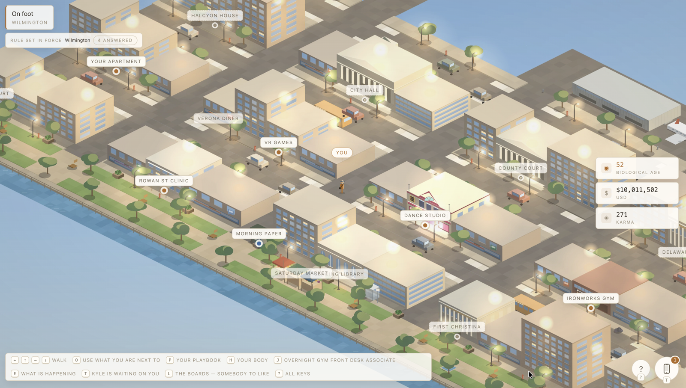
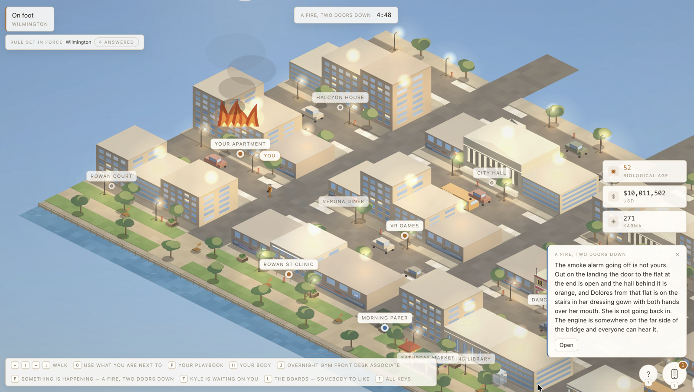
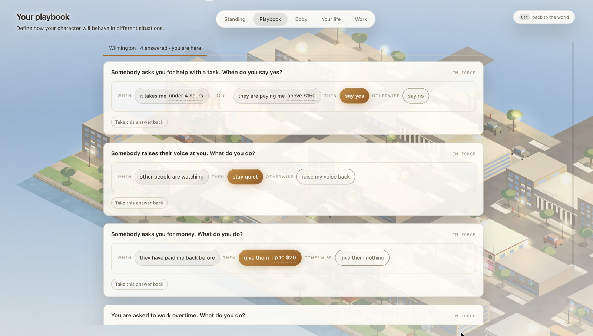
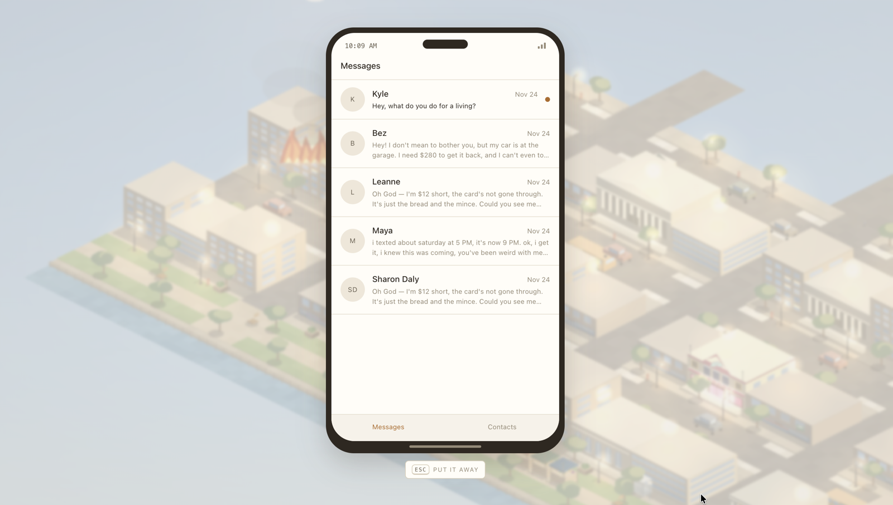
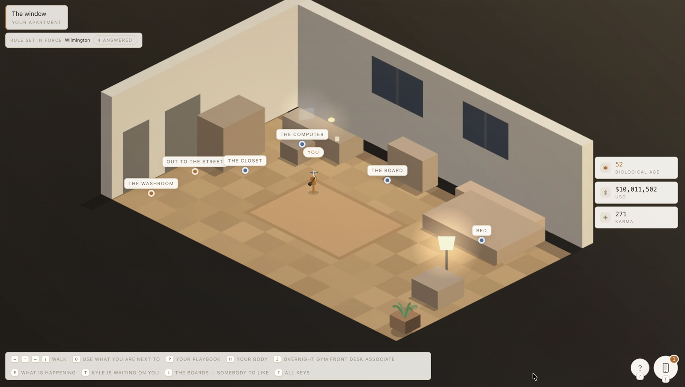

# Escape the Matrix

A life simulator about how rules depend on the people living under them.

You live a life one real day at a time: a job, a home, your health, money, and the people
around you. Every day those people bring you conflicts. You settle them by hand, or you write
standing rules that settle them for you. Rules that work among one population fail among
another. The game never tells you which rule is right, because no rule is right everywhere.

| | |
| --- | --- |
|  |  |
|  |  |

## The political vision

Most political games put you above the city: you set a tax rate and watch a chart move. This
game puts you inside it.

The goal is to simulate policy from the ground. You live under a minimum wage, a zoning rule,
a rent law, a policing approach or a welfare program as a resident does. You feel the policy as
a shift that was cut, a rent increase, a neighbor who moved away, or a clinic that opened. You
don't see the policy as a number.

The game is built around three ideas:

- **A policy is a rule set for a population.** The game already models people this way: each
  environment is a population with its own values, and the same choice earns opposite results in
  two of them. Policy is that mechanic scaled up from one person's rules to a city's.
- **No policy is correct everywhere.** A program that works in a trusting, cooperative community
  can be gamed in a transactional one, and a rule that keeps order in one place can cause harm
  in another. The player finds this out by moving between places and living in each one.
- **The game does not take sides.** The game never labels a policy as good or bad and never
  explains the result. Players form their own view from what happened to their character and to
  the people around them.

Later versions add elections, local government and organizing, so that players can push for the
rules they live under and then live with the results.

## Where the game is now

V1 is in active development. The game is set in one city, Wilmington, and has:

- jobs that each have their own wage, shift and requirements
- a health model in which biological age is computed from biomarkers
- a playbook of standing rules that settle daily conflicts with the people around you
- populations whose values differ, so a rule that works in one fails in another

Policy simulation is built on these systems and comes in later versions.

## Stack

Go backend (`cmd/`, `internal/`), React client (`web/`), Postgres, and authored content in
`content/*.yaml`.

- Setup and running locally: [`Documents/development.md`](Documents/development.md)
- Game design: [`Documents/HighLevelOverview.md`](Documents/HighLevelOverview.md)
- Architecture: [`Documents/technical.md`](Documents/technical.md)

## License

[AGPL-3.0](LICENSE)
